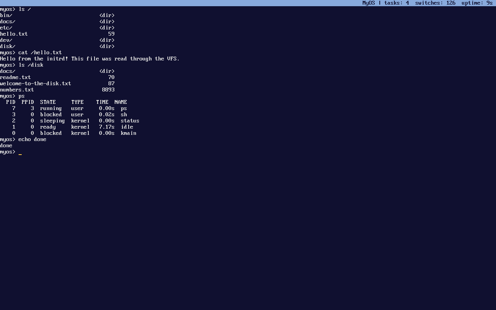

# MyOS

A small 64-bit x86 operating system kernel written from scratch in C (and a
little assembly), as a learning project. It boots with Limine in QEMU, runs
several user programs at once in ring 3, reads files from an initrd and a
FAT32 disk, and gives you a shell.



## Features

- **Boot:** Limine (BIOS, ISO), higher-half kernel at `0xffffffff80000000`, serial (COM1) logging, framebuffer text console with a PSF font, status bar
- **CPU:** own GDT + TSS (IST stack for double faults), IDT with 256 stubs, decoded exception reports (`#DE #GP #PF #DF ...`)
- **Interrupts:** 8259 PIC remapped to 32-47, PIT at 100 Hz, PS/2 keyboard, serial input
- **Memory:** bitmap PMM, 4-level paging with our own page tables (W^X for the kernel image, NX, WP), HHDM, free-list `kmalloc/kfree`
- **Tasks:** kernel threads, `switch_context` in assembly, preemptive round-robin scheduler (50 ms slices), sleep, wait queues, spinlocks, guarded kernel stacks
- **User mode:** per-process address spaces, ring 3 via `iretq`, syscalls via `int 0x80` and `syscall/sysret`, every user pointer checked, crashing programs are killed and the kernel goes on
- **Files:** VFS with file descriptors, initrd (USTAR tar) as `/`, `/dev/console`, `/dev/null`, ATA PIO disk driver and read-only FAT32 (long file names) at `/disk`
- **Programs:** ELF64 loader with `argc/argv`, `spawn` + `wait`, a small libc (`crt0`, `printf`, strings), and a shell with `ls cat echo ps uptime clear help`

## Build and run

Needs (Ubuntu / WSL2): `build-essential nasm gdb git make xorriso mtools qemu-system-x86`.

```bash
make run          # build everything and boot in QEMU (serial output in this terminal)
make debug        # QEMU waits for gdb on :1234, interrupts logged to qemu.log
make test         # boot all 45 in-kernel tests headless and check their output
make test T=shell # one test
make clean        # remove build output (make distclean also removes deps/)
```

In another terminal for `make debug`:

```bash
gdb build/myos.elf -ex 'target remote :1234' -ex 'break kmain' -ex continue
```

You can type into the shell in the QEMU window or in the terminal (serial).

## Layout

```
kernel/
  kmain.c, boot.c        entry point; everything Limine tells us
  arch/x86_64/           GDT/TSS, IDT, ISR stubs, IRQs, context switch, user mode, syscall entry
  mm/                    PMM (bitmap), VMM (paging), heap (kmalloc)
  sched/                 tasks, scheduler, wait queues
  proc/                  processes, ELF loader, built-in test programs
  syscall/               system calls (numbers shared with user space)
  fs/                    VFS, tarfs, devfs, FAT32
  drivers/               serial, framebuffer, console, PIC, PIT, keyboard, ATA
  lib/                   kprintf, string, panic, spinlock
  tests/                 in-kernel tests (run with test=<name>)
user/
  libc/                  crt0, syscall wrappers, printf, strings
  programs/              sh, ls, cat, echo, ps, uptime, hello, ...
  asm/                   first ring 3 programs (flat binaries, Stage 7)
initrd/                  files packed into the initrd (/)
disk/                    files copied onto the FAT32 disk (/disk)
tools/qemu-test.py       headless test runner
docs/                    the guide and one devlog per stage
```

## Progress

- [x] Setup: `make run` se QEMU mein boot
- [x] Stage 1: Hello on screen + serial
- [x] Stage 2: kprintf + panic
- [x] Stage 3: exceptions pakde ja rahe hain
- [x] Stage 4: keyboard + timer
- [x] Stage 5: PMM + paging + kmalloc
- [x] Stage 6: multitasking
- [x] Stage 7: user mode + syscalls
- [x] Stage 8: filesystem (initrd) + ATA/FAT32
- [x] Stage 9: ELF programs chal rahe hain
- [x] Stage 10: shell

Devlogs: [docs/devlog/](docs/devlog/). Each stage's notes say what was built,
why, which bugs came up and how they were fixed.

## Ideas for later

Pipes and I/O redirection in the shell, `cd` / working directories, FAT32
write support, APIC + SMP, saving FPU/SSE state per task, `brk`/`malloc` in
user space, virtio, networking.
